# Implementação RTL da CNN MNIST na ZCU102

Documentação de hardware e integração elaborada por Hyago Vieira Lemes Barbosa Sílva, líder técnico do G1-CIDigital.

Adaptação da CNN MNIST para a ZCU102, do fluxo AXI4-Stream e dos pesos do modelo da equipe por Hyago Vieira Lemes Barbosa Sílva.

O [top AXI4-Stream e o guia de integração](src/rtl/cnn_mnist/README.md) descrevem as conexões com os FIFOs do Block Design, os pesos do modelo, a simulação e a geração do XSA. O módulo `zcu102_cnn_mnist_axis` já consta no `mpsoc_preset.bd` atual; o Tcl de conexão serve para reconstruir essa integração em um projeto ainda não conectado.

## Modelo e fluxo de dados

A aplicação classifica imagens MNIST em escala de cinza, com 28 × 28 pixels. O software envia 784 bytes por imagem, em ordem de varredura por linhas (*raster scan*): do canto superior esquerdo para a direita e, depois, para a linha seguinte. Cada transferência ocorre quando `TVALID` e `TREADY` estão ativos; pausas no envio são permitidas. `TLAST` marca o último pixel.

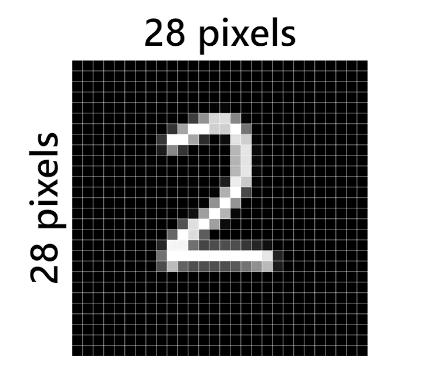

O adaptador AXI4-Stream atual **armazena os 784 pixels** antes de iniciar a inferência. Depois, ele reproduz os pixels para o núcleo da CNN e fornece os ciclos adicionais necessários para esvaziar o pipeline. Assim, a entrada externa aceita pausas, enquanto o núcleo recebe um fluxo contínuo. O processamento é de uma imagem por vez. O buffer da imagem completa e os buffers de linha internos têm funções distintas; enviar pixels em série não elimina o armazenamento do quadro neste top.

## Primeira convolução: janelas 5 × 5

O núcleo implementa convolução direta (*direct convolution*). `conv1_buf.v` organiza cinco linhas de 28 pixels, ou 140 posições de 8 bits, para montar janelas 5 × 5. Isso permite reaproveitar pixels entre janelas vizinhas. A forma como esse armazenamento será mapeado para recursos físicos da FPGA depende da síntese.

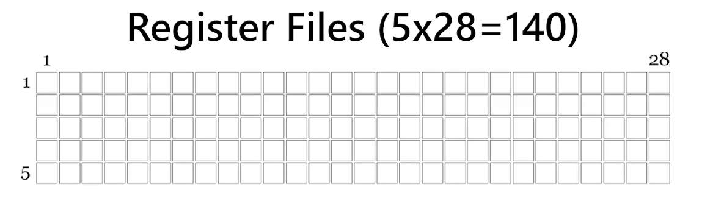

Uma janela avança uma coluna por vez até o fim da linha; depois, avança para a próxima linha. Sem preenchimento nas bordas (*valid convolution*), a dimensão espacial da saída é `(28 - 5 + 1) × (28 - 5 + 1) = 24 × 24`.

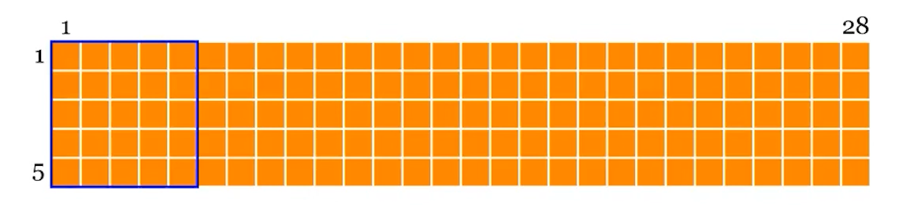

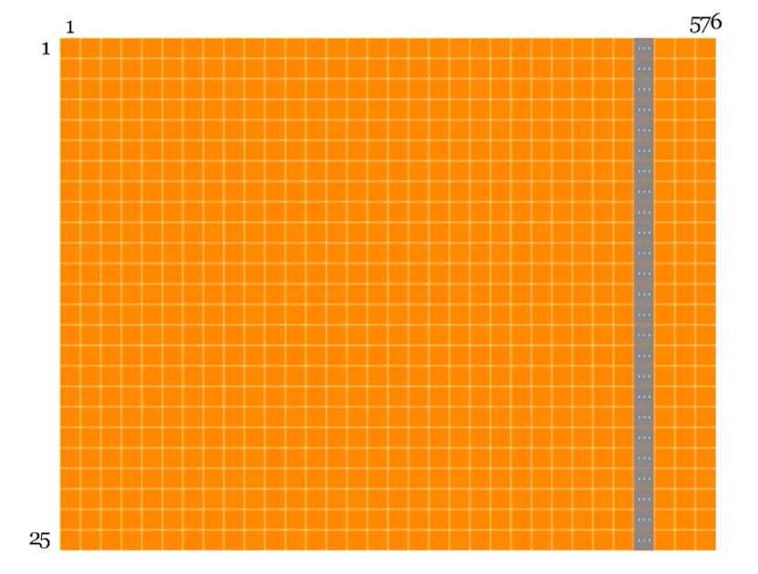

São 576 posições espaciais **por filtro**. A primeira camada possui três filtros, portanto produz três mapas de características de 24 × 24. Um `valid` acompanha cada resultado; a janela só é usada quando seus pixels estão disponíveis.

Para cada filtro, os 25 pixels da janela são multiplicados pelos 25 pesos correspondentes. Os produtos são somados e o viés é incorporado, respeitando as larguras e truncamentos definidos no RTL. A aritmética usa pesos e vieses exportados pelo modelo da equipe em 8 bits Q1.7; isso não significa que todos os valores intermediários tenham apenas 8 bits.

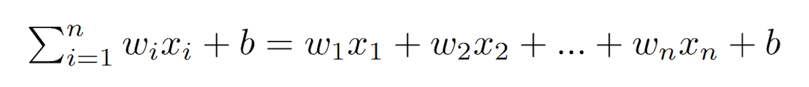

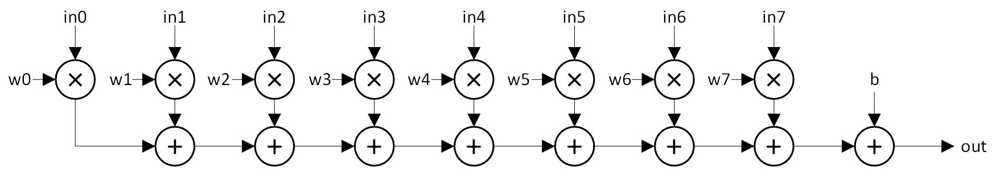

## Pipeline e timing

Uma soma extensa de produtos pode criar um caminho combinacional longo. Registradores de pipeline repartem o cálculo entre ciclos e podem facilitar o fechamento de timing, ao custo de latência. As figuras seguintes ilustram esse princípio; o número de registradores desenhado nelas não deve ser usado como contagem de recursos ou latência total do acelerador.

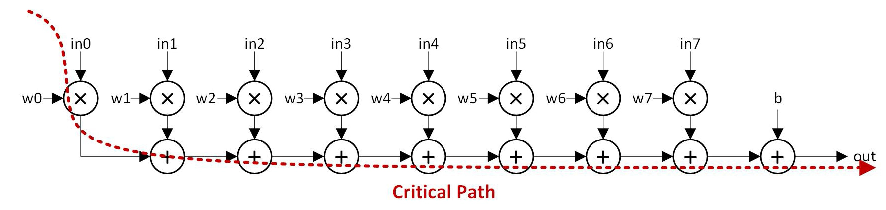

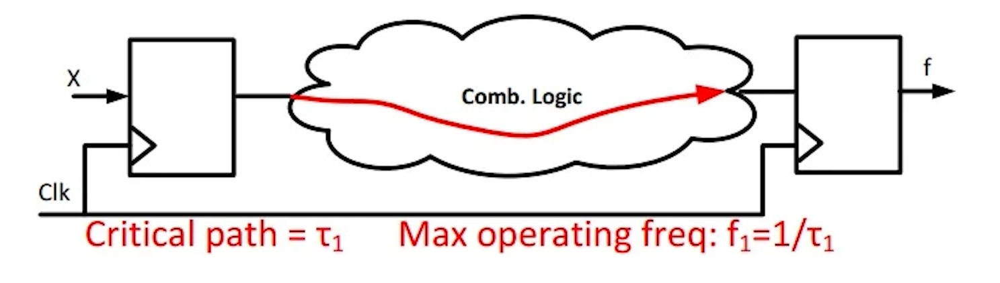

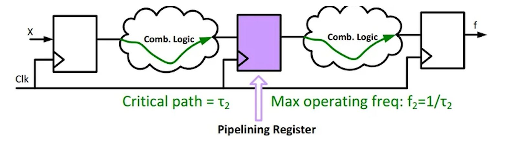

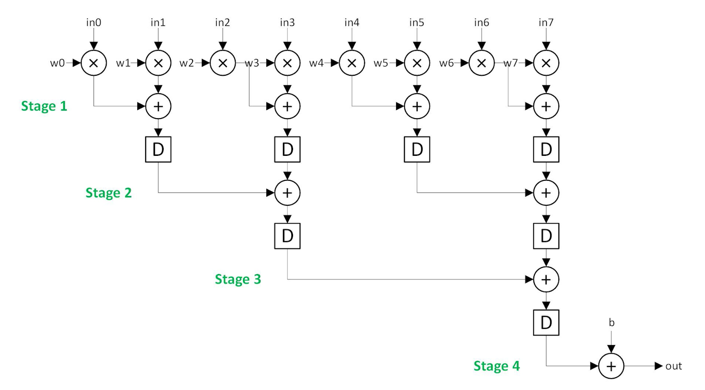

No `conv1_calc.v`, o sinal de validade passa por quatro registradores antes de `valid_out_calc`. Essa é apenas a latência **dessa etapa de cálculo**: o recebimento do quadro, os buffers, as demais camadas e a entrega AXI4-Stream acrescentam outros ciclos. A frequência máxima deve ser avaliada com restrições de clock e os relatórios de timing após síntese e implementação; a simulação funcional não a determina.

## Pooling, ReLU e classificação

Após a primeira convolução, o `maxpool_relu.v` seleciona o maior valor de cada região 2 × 2, sem sobreposição, e aplica ReLU (`max(0, x)`). Cada mapa de 24 × 24 passa a 12 × 12. O módulo mantém valores intermediários em buffers de 12 posições por canal; isso não equivale a armazenar todo o mapa 12 × 12.

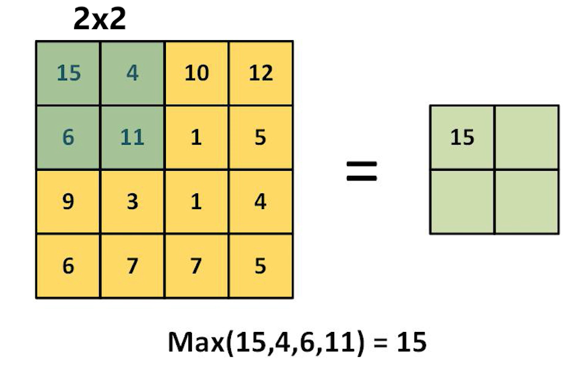

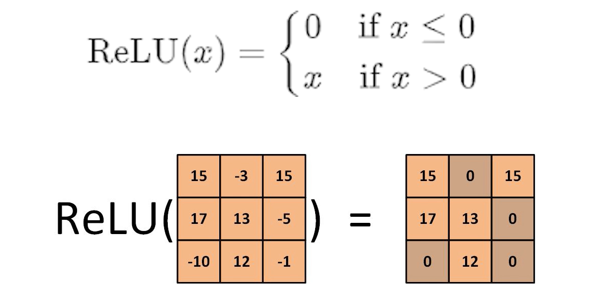

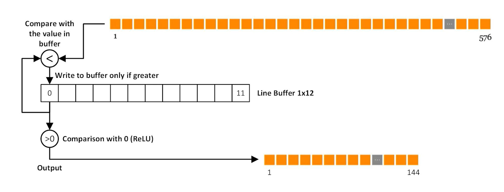

A segunda convolução recebe três mapas de 12 × 12, aplica filtros 5 × 5 e produz três mapas de 8 × 8. O segundo pooling reduz cada mapa a 4 × 4. Os 48 valores resultantes alimentam a camada `fully_connected`, que gera dez valores de saída. `comparator` seleciona o índice de maior valor, correspondente a uma classe de 0 a 9. A interface externa devolve **um byte por imagem**, com `TLAST=1`; ela não envia os dez valores intermediários.

## Top level e integração PS/PL

A figura abaixo resume as camadas internas. No projeto da ZCU102, `zcu102_cnn_mnist_axis.v` acrescenta a interface AXI4-Stream e o buffer de 784 bytes em torno desse pipeline.

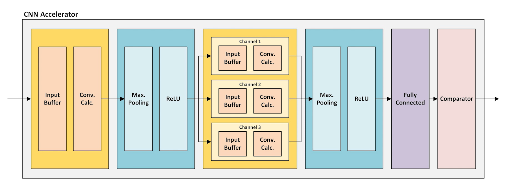

Na integração com o Processing System (PS), a imagem começa em um buffer na DDR. O canal **MM2S** do AXI DMA lê os bytes via interface AXI com acesso à memória e os entrega por AXI4-Stream ao FIFO de entrada. O caminho de dados segue `FIFO de entrada → CNN → FIFO de saída → S2MM do DMA → DDR`. O PS configura o DMA por AXI4-Lite e lê da DDR o byte de resultado. Os FIFOs desacoplam o fluxo; não fazem a classificação.

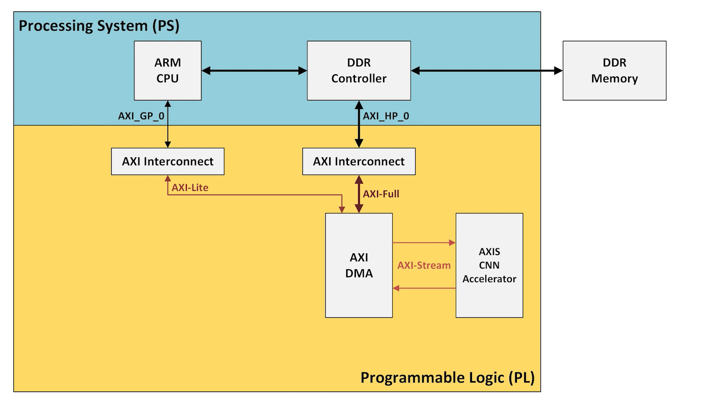

A figura é conceitual. Nomes de portas PS e interconexões efetivas devem ser conferidos no `mpsoc_preset.bd`. Para executar uma imagem, o software deve preparar primeiro a recepção S2MM de **1 byte** e então transmitir **784 bytes** por MM2S com `TLAST` no último pixel. Consulte o [contrato completo de sinais e os casos de quadro inválido](src/rtl/cnn_mnist/README.md).

## Síntese na ZCU102

O projeto usa a ZCU102 (`xczu9eg-ffvb1156-2-e`) e o clock `pl_clk0` do Zynq UltraScale+ MPSoC, configurado no Block Design para aproximadamente 99,99 MHz. A restrição de clock vem do IP do PS. O BD atual não expõe portas externas de LEDs. Por isso, as restrições em [zcu102_leds.xdc](src/constrs/zcu102_leds.xdc) estão comentadas; o arquivo conserva o mapeamento dos oito LEDs com `LVCMOS33`, conforme a tabela 3-33 do [guia UG1182 da AMD](https://docs.amd.com/api/khub/documents/rt6tROKcAceWoROXFPMY5w/content). Reative essas linhas apenas se restaurar `led_8bits_tri_o[7:0]` no BD e regenerar seu wrapper. Não adicione outro `create_clock` sobre `pl_clk0` no projeto completo.

Com o Vivado 2024.2 instalado em `C:\Xilinx\Vivado\2024.2`, execute na raiz do repositório, em PowerShell:

```powershell
& 'C:\Xilinx\Vivado\2024.2\bin\vivado.bat' -mode batch -source dev/hw/src/tcl/synth_zcu102_cnn_mnist.tcl -log dev/hw/build/cnn_synth.log -journal dev/hw/build/cnn_synth.jou
```

O [script de síntese](src/tcl/synth_zcu102_cnn_mnist.tcl) abre uma cópia datada em `.synth/` para preservar `dev/hw/vivado/ai_fpga.xpr`. Ele adiciona o XDC à cópia, valida o Block Design, confere o top e os 16 arquivos `.mem` da CNN, gera os produtos dos IPs e regenera o HDL wrapper a partir do BD antes de iniciar `synth_1`. Isso evita usar um wrapper importado com portas antigas. Se terminar, grava em `reports/` os relatórios de utilização, timing, `check_timing`, DRC, metodologia e estado dos IPs. Abra o `cnn.xpr` da cópia para continuar com implementação, bitstream e exportação do XSA. Leia principalmente a utilização de LUT, FF, BRAM e DSP, o WNS e os caminhos não restringidos. Síntese com WNS positivo ainda não comprova fechamento de timing após placement e routing; execute a implementação e confira o relatório final antes do bitstream e do XSA.

## Verificação e geração do XSA

O [testbench AXI4-Stream](src/tb/cnn_mnist/zcu102_cnn_mnist_axis_tb.v) exercita pausas de entrada e bloqueio temporário da saída. Com dois exemplos do diretório `dev/application/test`, a simulação Vivado 2024.2 retornou as mesmas classes que o modelo PyTorch: 1 e 3. Esse resultado valida esses casos, mas não mede acurácia geral, uso de recursos, timing ou funcionamento em placa.

Na verificação de 14 de outubro de 2026, a síntese do projeto completo terminou no Vivado 2024.2 após regenerar o wrapper para o BD atual, sem portas de LEDs. O run principal terminou com zero erros e zero avisos críticos. Os relatórios de síntese indicaram 24.347 LUTs, 15.354 registradores e 176 DSPs; a análise estimada a 100 MHz apresentou WNS de 5,242 ns e WHS de -0,096 ns. Esses valores incluem a CNN e os demais IPs do BD. O hold ainda precisa ser conferido após placement e routing; esses resultados não comprovam fechamento de timing ou funcionamento em placa.

Antes de exportar o XSA, confira os 16 arquivos `.mem` em **Sources**, valide o Block Design, gere o HDL wrapper, execute síntese e implementação, inspecione os relatórios de utilização e timing, gere o bitstream e exporte o hardware incluindo esse bitstream. Registre no projeto a versão do Vivado, o dispositivo `xczu9eg-ffvb1156-2-e`, a frequência alvo, as restrições de clock, os relatórios relevantes e a versão dos pesos usada no teste. O [guia do bloco](src/rtl/cnn_mnist/README.md) traz o comando da simulação e a sequência de integração.

Para o Vivado 2024.2, prefira sintetizar na instalação Windows já usada para a simulação, ou em uma distribuição Linux listada nos [sistemas operacionais suportados pela AMD](https://docs.amd.com/r/2024.2-English/ug973-vivado-release-notes-install-license/Supported-Operating-Systems). WSL não aparece nessa lista. A aprovação da simulação não implica bitstream gerado.

### Habilitar a licença de síntese

O `xczu9eg` da ZCU102 não consta entre os dispositivos Zynq UltraScale+ cobertos pelo Vivado ML Standard 2024.2; a [tabela de dispositivos da AMD](https://docs.amd.com/r/2024.2-English/ug973-vivado-release-notes-install-license/Supported-Devices) o inclui na edição Enterprise. Para testar a síntese no Vivado 2024.2:

1. No Windows onde o Vivado executará, abra **Manage AMD Licenses** / Vivado License Manager e consulte **View License Status**. Verifique se há licença válida para `Synthesis` e `Implementation` no `xczu9eg`.
2. Se não houver, entre no [AMD Product Licensing](https://account.amd.com/en/forms/license/license-form.html) com sua conta. A [documentação da versão 2024.2](https://docs.amd.com/r/2024.2-English/ug973-vivado-release-notes-install-license/Create-and-Generate-a-License-Key-File) descreve a licença **Vivado Design Suite: 30-Day Evaluation License**, que habilita as funções do Vivado. Selecione uma avaliação válida para a versão instalada e gere uma licença **node-locked** para o identificador da máquina onde fará a síntese. Confirme os termos e a duração apresentados na conta AMD antes de ativá-la.
3. Quando receber o arquivo `.lic`, use **Getting a License → Load License → Copy License** no License Manager. Confira novamente em **View License Status** e repita o comando de síntese acima. As [instruções de instalação da AMD](https://docs.amd.com/r/2024.2-English/ug973-vivado-release-notes-install-license/Install-Certificate-Based-Node-Locked-License-Key-File) mostram esse procedimento.

Se a universidade participa do [AMD University Program](https://www.amd.com/en/corporate/university-program.html), consulte o responsável pelo laboratório sobre uma licença Enterprise acadêmica. Confira separadamente os requisitos de licença dos IPs do Block Design antes de gerar o bitstream.
